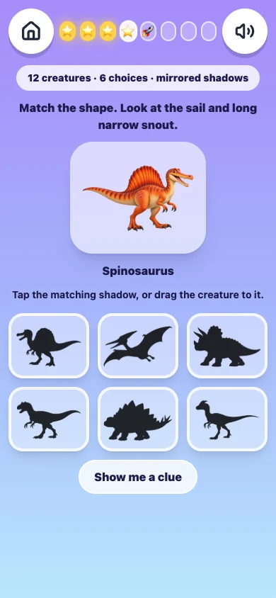
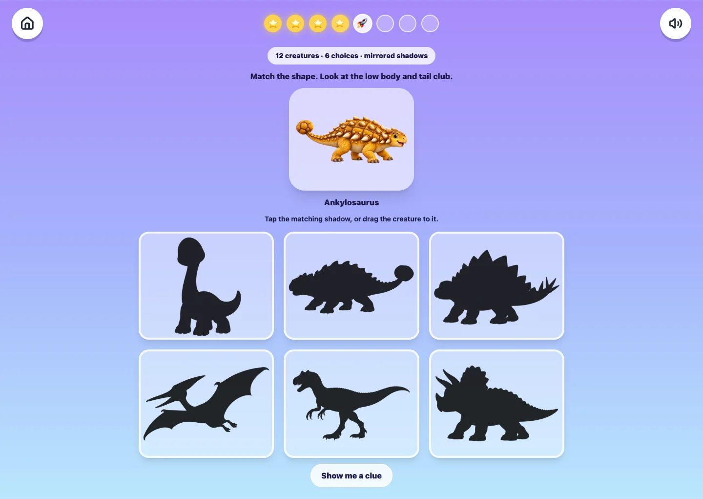
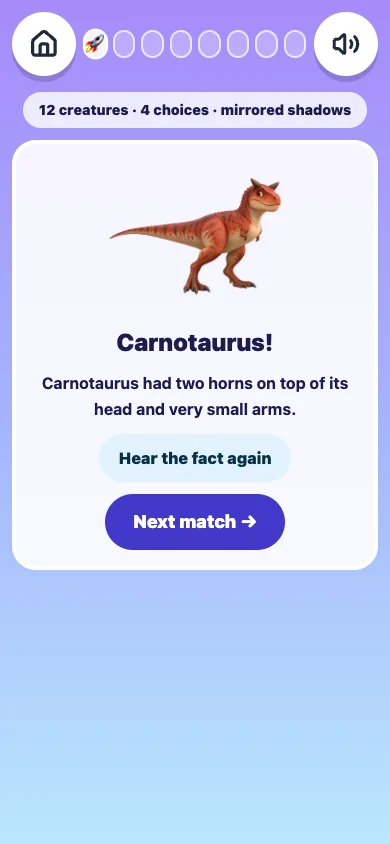

# Shadow Match: twelve-creature progression

Targeted release dated 23 October 2026. This closes the requested dinosaur-roster and increasing-difficulty uplift. It does not assign a new all-game editorial score.

## Acceptance instructions

| Area | Required result |
|---|---|
| Progression | Earn all five levels through actual controls: pools of 3, 6, 8, 10, 12 creatures; 4, 5, 6, 7, 8 matches respectively. |
| Increasing challenge | Choices grow from 2 to 6. Later levels include available similar-body distractors; final shadows are mirrored. |
| New creatures | Six new illustrated species appear as actual targets at their introduction, not only as wrong choices. No target repeats before its pool is exhausted. |
| Accurate matching | Each silhouette uses the exact source image and alpha, with a black filter. Exactly one matching choice, unique options, randomized target and answer positions. |
| Readable interaction | At 390px and 1440px: no horizontal overflow; choices at least 48px; visible instruction, current species and optional clue. |
| Recovery and access | Wrong answer retains the round and gives visible feedback; keyboard Enter, mouse drag and native touch drag work; cancelled touch does not credit a match. |
| Learning | Correct match displays a fact until explicit Next match, including after six seconds. Replay uses existing packaged recordings; Pterodactyl replays its name and explicitly labels the visible classification fact as a flying reptile. |
| Progress safety | Earned level and stars persist through reload; player records retain the existing schema and never require migration. |
| Operational | Build, meaningful progression/art tests, emitted service-worker audit, actual production playthroughs, decoded images, console and provider-call guards. |

## Delivered

Six additional species: Spinosaurus, Parasaurolophus, Allosaurus, Dilophosaurus, Carnotaurus and Corythosaurus. The original six remain. This roster is scoped to Shadow Match; other games' shared dinosaur data is unchanged.

New creatures are introduced first in a shuffled target queue. In later levels, available close comparisons are deliberately included: for example the two crested duck-bills, or two-legged hunters. The final level reaches six choices and mirrors all silhouettes. A manual clue is available; later levels do not automatically reveal the answer on the first attempt.

Correct answers hold a readable fact and an explicit Next match. Eleven facts reuse existing packaged recordings; the flying reptile's classification is visible and its existing name recording is clearly labelled. No new paid voice or story requests were made.

## Evidence and limits

- Runtime commit and deployment: see candidate and canonical identity JSON beside this report.
- `local-390.json` and `local-1440.json`: all 30 matches, all twelve targets, all five levels, saved level 5 and three stars. Those full local runs preceded a small visible wrong-answer-status addition; production runs cover the final source.
- Browser tests use one contained headless Chromium session and one tab. Only the synthetic Askia progression ledger is cleared for each full run. Levels, stars and unlocks are earned using actual controls; no progression or answer-state injection. Real child data is untouched.
- Automated playback proves media starts and its playhead advances; it is not an independent pronunciation or loudness listening review. No new editorial score is claimed.
- Existing build chunk-size advisory remains. The full suite has one generic PWA check skipped without the emitted-build environment; the separate emitted-PWA audit runs with `PWA_BUILD_DIR=dist`.

## Artwork provenance and learning sources

`art-provenance.json` records original and runtime SHA-256 hashes. Six built-in generated originals are kept once in the Codex generated-images directory. Runtime images are transparent 800×640 WebP derivatives. Silhouettes derive directly from those same runtime files. Colours and appearance are stylized reconstructions.

Anatomical references: [NHM Carnotaurus](https://www.nhm.ac.uk/discover/dino-directory/carnotaurus.html), [NHM Dilophosaurus](https://www.nhm.ac.uk/discover/dino-directory/dilophosaurus.html), [NHM Corythosaurus](https://www.nhm.ac.uk/discover/dino-directory/corythosaurus.html), and the [NHM dinosaur directory](https://www.nhm.ac.uk/discover/dino-directory.html). Existing reviewed factual narration is reused verbatim.

## Final verification

- Runtime `4fd1b8b8922cbd3b5dbf64444e0abbaa065f4aee`; canonical deployment `dpl_EzpDxKaAXaGjPj7ogZsFeev7BrjT` is READY.
- Production: **60 matches total**, all five levels and all twelve creatures at **both 390×844 and 1440×844**. Correct-match replay advanced decoded packaged audio in every round; zero observed page/console errors, broken Shadow Match images or provider requests.
- Production touch drag, touch cancellation, visible sound-off wrong-answer feedback and level-5 re-entry passed. Cancelled dragging is checked after the piece's 200ms spring-back transition before the next gesture.
- Wrong answer/recovery, manual clue, keyboard Enter, mouse dragging, six-second held fact, explicit Next and saved level/three-star ledger passed.
- Full suite: **348 passed, 1 existing skip, 0 failed**. Emitted-PWA audit: **8 passed, 0 skipped**. Scoped ESLint and production build passed.
- Candidate and canonical entry bundle hashes match; all six newly served images match committed source bytes (`served-runtime.json`). The local build entry has a different hash from the Vercel build and is not represented as byte-identical.
- Native rehearsal source is preserved in `rehearsal.cjs` (replace QA_ORIGIN and VIEW_WIDTH). Touch source assumes the retained level-5 intro. Raw audio evidence may contain multiple instrumentation rows for the same media element after repeated initialization in the reused session; these are not additional provider calls or separate playback requests.

### Representative production views

### Storage close-out

No worktrees, clones or dependency installations created. Six runtime images add **357,298 bytes**. Six generated PNG originals (**11,489,324 bytes**) are retained once in Codex's generated-images directory and referenced by hash; they are not copied into the repository. Compact QA JSON, replay code and three WebP screenshots are retained here. Duplicate task-owned PNG screenshots and parsed raw rehearsal logs were removed. Existing unrelated untracked evidence is preserved.

## Open-tab refresh follow-up

The user's existing in-app tab was still running the pre-release game code (generic shadow labels and no new roster indicator). A normal reload loaded the current production release. The retained level 3 then visibly showed the new Parasaurolophus artwork and eight-creature pool. No answers were completed and no child records were reset. Fresh checks confirmed service-worker cache v26 and all six artwork hashes. A duplicate deployment was unnecessary because the canonical alias already served the released runtime.

Quiet hourly monitoring is active. It always checks deployment identity, entry, service worker and artwork hashes. Native controls are checked only when the existing isolated QA session is available; that daemon was closed during this follow-up, so no fresh isolated gameplay health claim is made. The previous 60-match production rehearsal remains recorded separately. No replacement browser windows are launched. See `post-refresh-verification.json`.
